# Drawing with files

*Part 4 of the course: after "Advanced drawing with OPENRNDR and orx"*

Until now, everything your programs drew came from the code itself. In this course your
programs read **files**: tables of data (CSV files) and folders full of images. First you draw
with real data about the planets, then with data you download from the internet, then with your
own data. In the second half you work with a small archive of famous paintings, make random
collages, and then do the same with your own photos. At the end you build a collage tool that
combines your images and your data, using the layers and the GUI from the advanced course.

As before, each part has:

- a short explanation (this document)
- a program you can run: `src/main/kotlin/files/Files01.kt` up to `Files10.kt`
- an **exercise** (also at the bottom of each program)
- a slide: `slides/slide01.png` up to `slide10.png` (plus a text version, `.txt`)

The files used in this course:

| file or folder                | what is in it                                                |
|-------------------------------|--------------------------------------------------------------|
| `data/csv/planets.csv`        | the eight planets: size, distance to the Sun, temperature… (NASA) |
| `data/csv/image-archive.csv`  | title, artist and year of every image in the archive         |
| `data/csv/SOURCES.md`         | where the data and the images come from                      |
| `data/image-archive/`         | ten famous paintings and photographs, all public domain      |
| `data/my-images/`             | empty: for **your** images (part 9 and 10)                   |
| `data/csv/penguins.csv`       | not there yet: you download it in part 5                     |

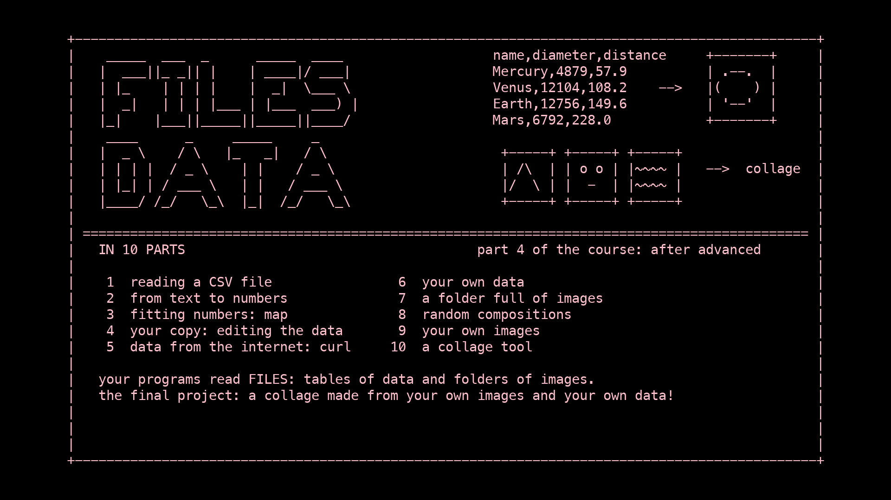

---

## Part 1 — Reading a CSV file

**Program:** `Files01.kt` · **New:** CSV files, `csvReader()`, `readAllWithHeader`, `getValue`

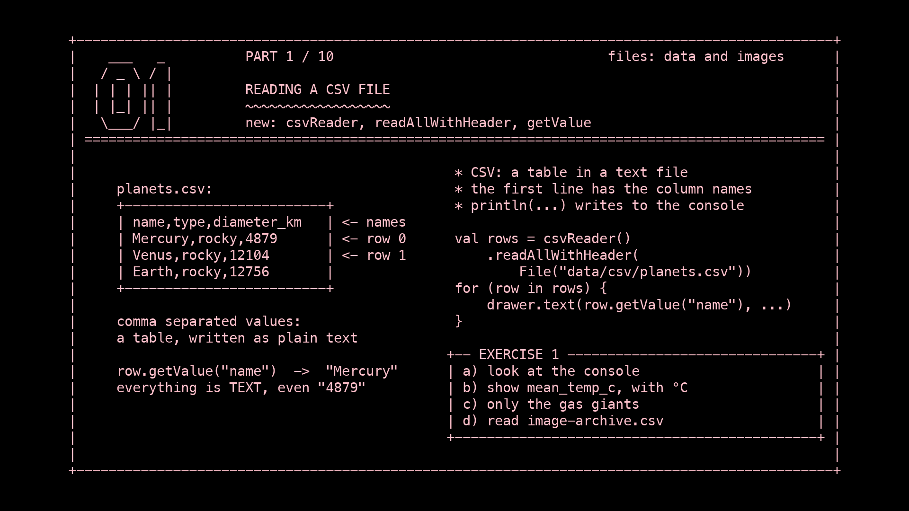

A **CSV** file ("comma separated values") is a table written as plain text. Open
`data/csv/planets.csv` in IntelliJ:

```
name,type,diameter_km,distance_million_km,orbit_days,day_hours,mean_temp_c
Mercury,rocky,4879,57.9,88.0,4222.6,167
Venus,rocky,12104,108.2,224.7,2802.0,464
...
```

- the **first line** has the column names
- every other line is one **row**
- **commas** separate the columns

Every spreadsheet program (Excel, Numbers, Google Sheets) can open and save CSV files. This one
comes from NASA; `data/csv/SOURCES.md` explains every column.

Reading it takes one line (the CSV reader comes from the kotlin-csv library, which is already
added to this project):

```kotlin
val rows = csvReader().readAllWithHeader(File("data/csv/planets.csv"))
```

`rows` is a **list** (drawing part 5) with one entry per row. Each row knows its values by
column name:

```kotlin
rows[0].getValue("name")     // "Mercury"
rows[2].getValue("type")     // "rocky"
```

**Everything read from a file is text** (a `String`), even `"4879"`. Part 2 turns text into
numbers.

`println(...)` writes to the **console** at the bottom of IntelliJ, not in the window. The
program prints every row there: very handy to see what's inside your data.

### Exercise 1

1. Look at the console: what does one row look like when you `println` it?
2. Show the column `mean_temp_c` instead of the diameter, with `" °C"` behind it.
3. Only write the planets of the type `"gas giant"` (an `if`). The rows now leave gaps: fix it
   with a `var y`.
4. Read `data/csv/image-archive.csv` in the same way and write the titles of the paintings.

---

## Part 2 — From text to numbers

**Program:** `Files02.kt` · **New:** `toDouble()`, drawing with numbers from a file

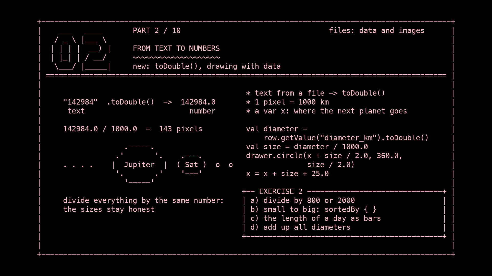

`"142984"` is text: you can't use it as a size. `toDouble()` turns it into a number:

```kotlin
val diameter = row.getValue("diameter_km").toDouble()     // 142984.0
```

Now we can draw with it. Jupiter is 142,984 km wide, far too big for our window, so we divide
by 1000: then Jupiter is 143 pixels wide and Mercury 5. Dividing **everything** by the same
number keeps the sizes honest: Jupiter is still 29 times as wide as Mercury.

The planets are placed next to each other. A `var x` keeps track of where the next planet goes.
After each planet, `x` moves on by the width of that planet plus a gap of 25 pixels. The names
are written at an angle (`isolated`, `translate`, `rotate`, drawing part 10), so the names of
the small planets don't overlap.

### Exercise 2

1. Divide by `800.0` instead of `1000.0`, and by `2000.0`. What changes, and what stays the
   same?
2. Order the planets from small to big:
   `val sorted = rows.sortedBy { it.getValue("diameter_km").toDouble() }`, and loop over
   `sorted`.
3. Draw the length of a day (`day_hours`) as a bar under each planet. What do you need to divide
   by to make it fit?
4. Add up all the diameters in a `var total` and write the total in the window.

---

## Part 3 — Fitting numbers in the window

**Program:** `Files03.kt` · **New:** `map(...)`, colours from numbers, finding the largest value

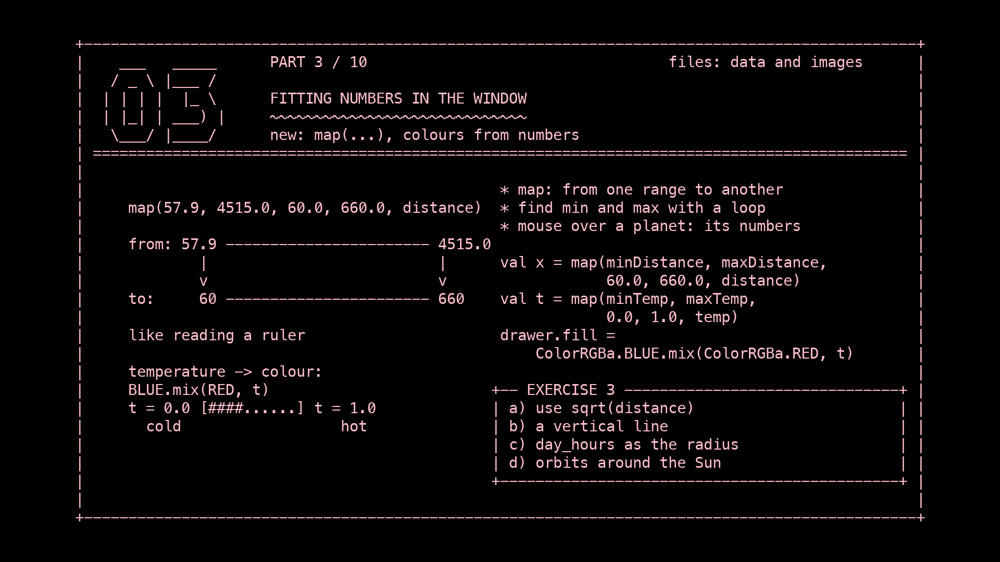

The distances to the Sun go from 57.9 to 4515 million km, but we want them between x = 60 and
x = 660 pixels. `map` does that for us, like reading a ruler:

```kotlin
val x = map(57.9, 4515.0, 60.0, 660.0, distance)
//          from this range   to this range   this value
```

| value of `distance` | `x` becomes |
|---------------------|-------------|
| 57.9 (the smallest) | 60          |
| 4515.0 (the largest) | 660        |
| something in between | in between |

Instead of typing 57.9 and 4515.0, the program **finds** the smallest and largest value with a
loop. Then it still works when the data changes:

```kotlin
var maxDistance = -Double.MAX_VALUE        // smaller than any number
for (row in rows) {
    val distance = row.getValue("distance_million_km").toDouble()
    if (distance > maxDistance) maxDistance = distance
}
```

Colours can come from numbers too. `map` turns the temperature into a number `t` between `0.0`
and `1.0`, and `ColorRGBa.BLUE.mix(ColorRGBa.RED, t)` turns that into a colour between blue
(cold) and red (hot).

Move the mouse over a planet to see its numbers. `distanceTo` (how far the mouse is from the
centre of a planet) tells whether the mouse is on it.

### Exercise 3

1. The four small planets are squashed together on the left. Use the square root of the
   distance instead, `kotlin.math.sqrt(distance)`, for the minimum, the maximum and `x`.
2. Put the planets on a vertical line: use `map` for `y` instead of `x`.
3. Use `day_hours` for the radius. Which planet wins now?
4. Draw an orbit for every planet: a circle around the Sun with the distance as its radius.

---

## Part 4 — Your copy: editing the data

**Program:** `Files04.kt` · **New:** `File(...).exists()`, `toDoubleOrNull()`, `row["column"]`,
`null` and `?:`

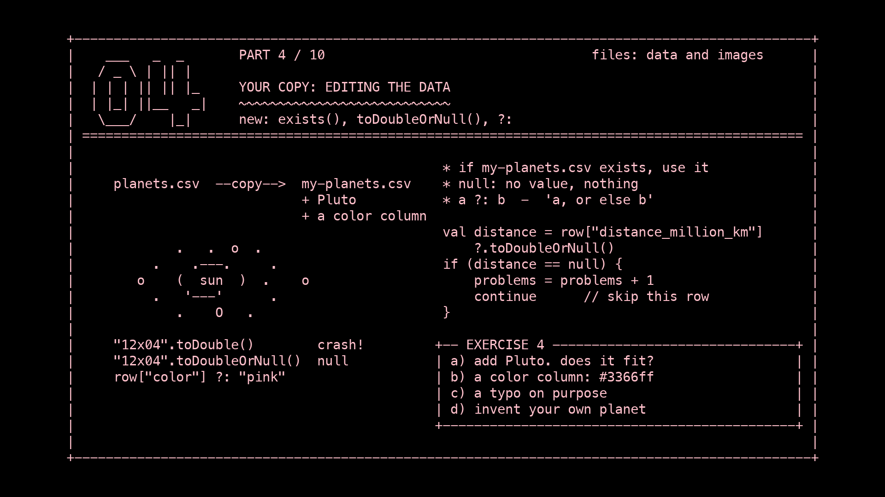

Data isn't sacred: you can copy it and change it. This program reads **your copy**,
`data/csv/my-planets.csv`. As long as that file doesn't exist, it reads `planets.csv`:

```kotlin
val myFile = File("data/csv/my-planets.csv")
val file = if (myFile.exists()) myFile else File("data/csv/planets.csv")
```

**Making your copy in IntelliJ:** right-click `data/csv/planets.csv` and choose **Copy**,
right-click the folder `data/csv` and choose **Paste**, then name the copy `my-planets.csv`.
Open it and change things.

When people edit files by hand, things go wrong. A good program doesn't crash on a typo:

| you write                   | when it goes wrong…                         |
|-----------------------------|---------------------------------------------|
| `"12x04".toDouble()`        | the program **crashes**                     |
| `"12x04".toDoubleOrNull()`  | you get `null`: "nothing", no number        |
| `row.getValue("color")`     | **crashes** if there's no column `color`    |
| `row["color"]`              | gives `null` if there's no column `color`   |

- **`null`** means "there is nothing here".
- **`a ?: b`** means "a, or if a is null, then b": a default value. `row["name"] ?: "?"`
  gives the name, or `"?"` if there isn't one.
- **`?.`** only continues if the left side isn't null. `row["diameter_km"]?.toDoubleOrNull()`
  is null when the column is missing *or* when it's not a number.
- **`continue`** skips the rest of the loop for this row and goes on with the next one.

The program counts the rows it had to skip and shows the count in red.

The planets also **move**: each one goes around the Sun at its real speed compared to the
others. In this program one Earth year takes 3 seconds.

### Exercise 4

1. Make `my-planets.csv` and add Pluto, the dwarf planet, as a new line:
   `Pluto,dwarf,2376,5906.4,90560,153.3,-225`. Does everything still fit in the window? Why
   (not)? Fix it.
2. Add a column `color` (add `,color` to the first line) and give the planets colours like
   `#3366ff`. You can leave some empty.
3. Make a typo on purpose: write `12x04` as the diameter of Venus. What happens?
4. Invent a planet of your own. What does it look like? How long is its year?

---

## Part 5 — Data from the internet

**Program:** `Files05.kt` · **New:** downloading with `curl`, a scatter plot, missing values

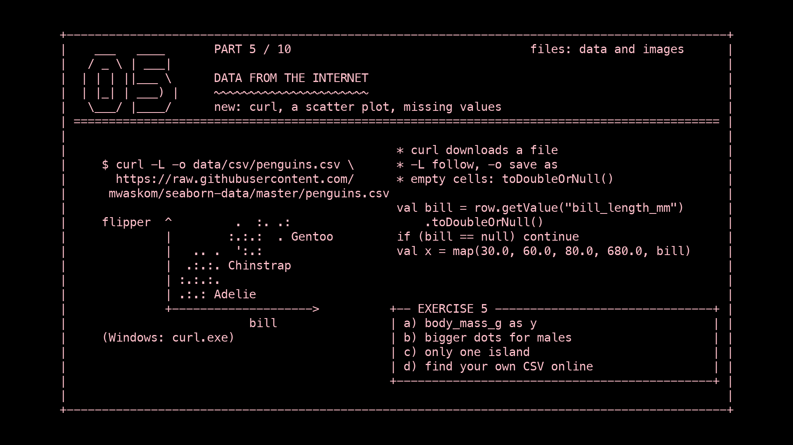

Lots of data is shared online as CSV. We download a real research data set: measurements of 344
penguins on three islands in Antarctica, the *Palmer Penguins*.

Open the **Terminal** in IntelliJ (*View → Tool Windows → Terminal*) and type this on one line:

```
curl -L -o data/csv/penguins.csv https://raw.githubusercontent.com/mwaskom/seaborn-data/master/penguins.csv
```

| part        | meaning                                             |
|-------------|-----------------------------------------------------|
| `curl`      | a program that downloads things                     |
| `-L`        | follow the link if the file has moved               |
| `-o …`      | save it **here** (o for *output*)                   |
| `https://…` | where to download it from                           |

> **On Windows**, type `curl.exe` instead of `curl`. Check that it worked: `penguins.csv` should
> now be in `data/csv`. Open it in IntelliJ: 345 lines.

Run the program. Each penguin becomes a dot: **x** is the length of its bill (beak), **y** the
length of its flipper (wing), and the **colour** is its species. Three groups appear: the three
species look different, and the data shows it.

**Real data is messy.** Two penguins couldn't be measured, so their cells are empty:
`Adelie,Torgersen,,,,,`. `toDoubleOrNull()` (part 4) gives `null` for an empty cell, and we skip
that penguin with `continue`.

As long as the file isn't there, the program shows a message instead.
`return@extend` stops drawing for that frame.

### Exercise 5

1. Use `body_mass_g` (2700–6300 grams) for y instead of the flipper length.
2. Make the dots of male penguins bigger than the female ones (column `sex`).
3. Only draw the penguins of one island (column `island`: Biscoe, Dream or Torgersen).
4. Find another CSV online, download it with `curl`, and look inside. The seaborn-data
   collection (https://github.com/mwaskom/seaborn-data) has many: open one, click **Raw**, and
   use that address.

---

## Part 6 — Your own data

**Program:** `Files06.kt` · **New:** column names from the file, `;` as a separator, decimal
commas, arrow keys

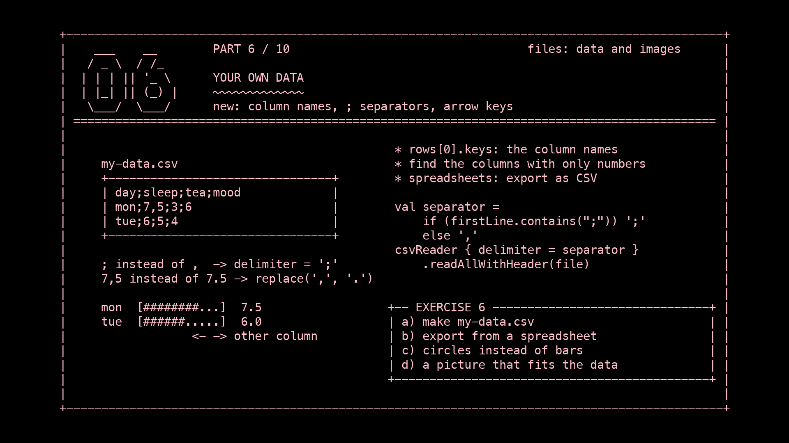

Now collect **your own data** and save it as `data/csv/my-data.csv`. Some ideas:

- **your week:** day, hours of sleep, cups of tea, minutes on your phone, mood (1–10)
- **your music:** song, artist, year, length in seconds, times played
- **your street:** house number, number of windows, colour of the door, plants in the garden

Make it in a spreadsheet and save or download it as CSV (Google Sheets: *File → Download →
Comma separated values*; Excel and Numbers: *Export* or *Save As… → CSV*), or type it straight
into IntelliJ. Put the column names on the first line.

This program works with (almost) **any** CSV file:

- it reads the column names from the file: `rows[0].keys`
- it finds out which columns contain **only numbers**
- it draws a bar chart of one of those columns, and the **arrow keys** choose another one

Two things that often go wrong with spreadsheets, which the program handles:

| problem | example | solution |
|---|---|---|
| Dutch (and other) versions of Excel put `;` between the columns | `mon;7,5;3` | if the first line contains `;`, read with `csvReader { delimiter = ';' }` |
| a decimal comma instead of a decimal point | `7,5` | `replace(',', '.')` before `toDoubleOrNull()` |

Until `my-data.csv` exists, the program shows `planets.csv`.

### Exercise 6

1. Make `data/csv/my-data.csv` with at least 5 rows and 3 number columns. Run the program.
2. Export your data from a spreadsheet as CSV and put it in `data/csv`. Can the program read it?
3. Draw a circle per row instead of a bar, with the value as its size.
4. Throw away the bar chart and draw a picture that **fits** your data: hours of sleep as moons,
   cups of tea as cups, songs as records…

---

## Part 7 — A folder full of images

**Program:** `Files07.kt` · **New:** `listFiles()`, filtering file names, a list of images,
data + images

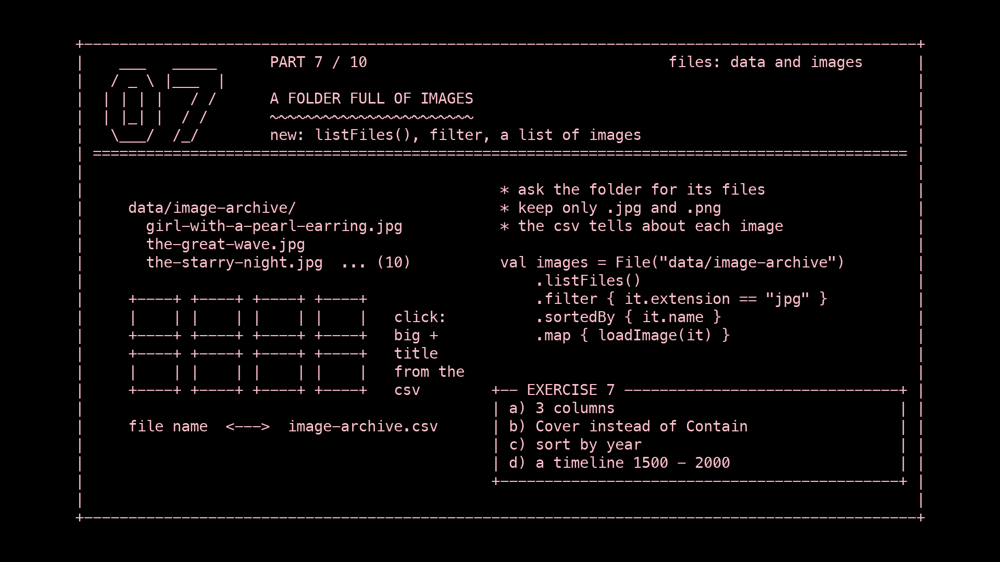

`data/image-archive` contains ten famous paintings and photographs, from Vermeer to the first
photo of the whole Earth. They're all in the **public domain**, so anyone may use them. See
`data/csv/SOURCES.md`.

Instead of loading each image by name, we ask the folder which files are in it:

```kotlin
val files = File("data/image-archive").listFiles()   // all files in the folder
    .filter { it.extension == "jpg" || it.extension == "png" }   // only images
    .sortedBy { it.name }                            // in alphabetical order
val images = files.map { loadImage(it) }             // load them all
```

`filter`, `sortedBy` and `map` each make a new list from a list. `it` is the item being
looked at.

**Data + images.** `data/csv/image-archive.csv` has a row for every image, with its title,
artist and year. The column `file` connects a row to an image, because it holds the same file
name. **Click** an image to see it big, with its information; click again to go back.

### Exercise 7

1. Make the grid 3 columns wide. What else do you need to change?
2. Use `FitMethod.Cover` in the grid. Which works better for a contact sheet?
3. Sort the images by year instead of by name (read the year from the CSV for every file).
4. Make a timeline: put every image on a line from 1500 to 2000, using `map` (part 3) and the
   year from the CSV.

---

## Part 8 — Random compositions

**Program:** `Files08.kt` · **New:** `Random(seed)`, `nextDouble()`, `random()`, cutting with
`imageFit`

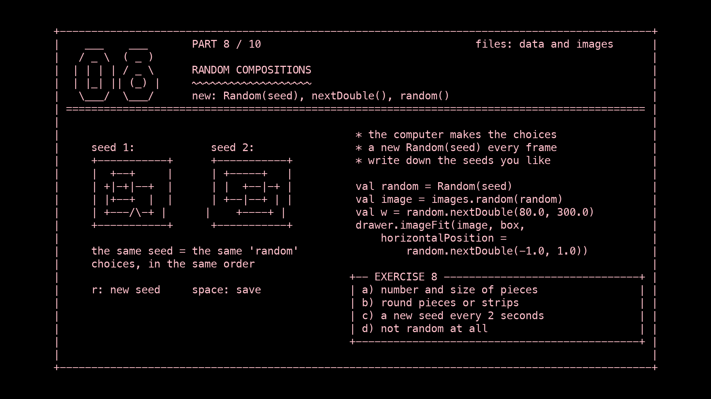

Let the computer make the choices: which image, where, how big, at what angle.

| you write                           | you get                                   |
|-------------------------------------|-------------------------------------------|
| `random.nextDouble(100.0, 300.0)`   | a random number between 100 and 300        |
| `random.nextInt(0, 10)`             | a random whole number: 0, 1, … 9          |
| `images.random(random)`             | a random image from the list               |

**The seed.** `Random(seed)` starts the randomness at a fixed point. The **same seed always gives
the same "random" choices**, in the same order. That's why we make a new `Random(seed)` every
frame: the composition stays still instead of changing 60 times a second. Press **r** for a new
seed and a new composition. Found one you like? Write down its seed and you can always get it
back. **Space** saves a picture.

**Random details.** `imageFit` (advanced part 4) cuts an image to fit a rectangle, and
`horizontalPosition` and `verticalPosition` (from -1.0 to 1.0) choose **which part** you see.
Random positions give random details of the paintings.

### Exercise 8

1. Change the number of pieces and their smallest and largest size.
2. Make the pieces round (a compositor layer with a mask, advanced part 7), or make narrow
   strips 10–40 pixels wide and 720 high.
3. Let the composition change by itself: `seed = (seconds / 2.0).toInt()`.
4. Make a composition that isn't random at all but still uses all ten images. Which do you
   prefer?

---

## Part 9 — Your own images

**Program:** `Files09.kt` · **New:** your own folder, `mkdirs()`, cutting images into tiles,
`keyboard.character`

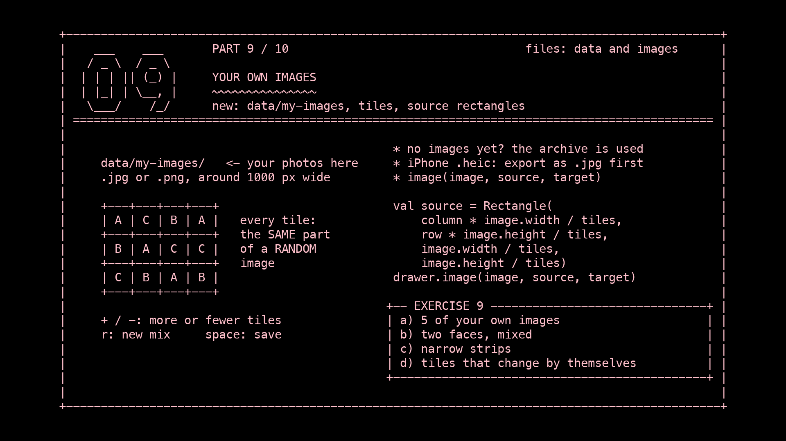

Now use **your own pictures**: photos from your phone, scans, drawings. Put them in the folder
`data/my-images`. The program creates that folder with `File(...).mkdirs()` if it doesn't exist
yet. Until there are images in it, it uses the archive.

**Tips for your own images:**

- Only `.jpg` and `.png` work. iPhone photos are often `.heic`: export them as JPEG first
  (*Photos → File → Export*).
- Make them **smaller**. A phone photo is about 4000 pixels wide; around 1000 is plenty and
  loads much faster. (Mac: open in *Preview → Tools → Adjust Size*. Windows: *Photos → … →
  Resize image*.)
- 5 to 20 images is a good number.

**The picture.** The window is cut into a grid of tiles. Every tile shows the **same part** of a
**random** image, so all images stay in place and together form one patchwork picture:

```kotlin
drawer.image(image, source, target)
//   source: which part of the image (in the image's own pixels)
//   target: where in the window it goes
```

Keys: **+** and **-** change the number of tiles, **r** gives a new mix, **space** saves.
`keyboard.character` gives the character you typed, so `+` also works when you need shift
for it.

### Exercise 9

1. Put at least 5 of your own images in `data/my-images` and run the program.
2. Use just two images: two faces, photographed from the same distance. What happens?
3. Make the tiles narrow strips: 1 row and 40 columns.
4. Let the tiles change by themselves: give every tile its own `Random`, with a seed that changes
   every few seconds, like `Random(row * 100 + column + (seconds * 2.0).toInt())`.

---

## Part 10 — A collage tool

**Program:** `Files10.kt` · **New:** everything together: images, data, randomness, layers and
a `WindowedGUI`

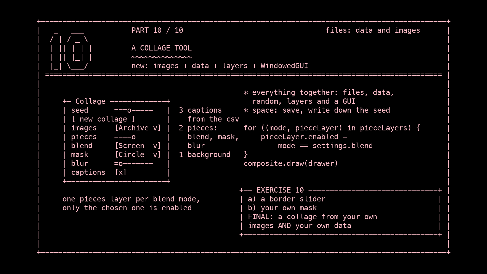

The last program is a **tool** for making collages, like the painter in advanced part 10. It
combines this course (images from folders, random compositions, data from a CSV) with the
advanced course (layers, blend modes, masks, post processing and a `WindowedGUI`).

The collage has three layers (advanced part 6):

| layer | what's on it | from |
|---|---|---|
| 3 | the **captions**: title and year of every image used | `image-archive.csv` (part 7) |
| 2 | the **pieces**: random cut-outs with a blend mode, a mask and a blur | part 8, advanced 7–8 |
| 1 | the **background**: one image, darkened | part 8 |

The GUI window controls everything: the seed (and a **new collage** button), archive or your
own images, the number and size of the pieces, rotation, blend mode, mask, blur and captions.

**Choosing a blend mode in the GUI.** A layer's blend mode is fixed when the layer is made. So
the program makes the pieces layer once for **every** blend mode and switches on only the chosen
one:

```kotlin
for ((mode, pieceLayer) in pieceLayers) {
    pieceLayer.enabled = mode == settings.blend
}
```

`CollageBlend`, `CollageMask` and `CollageImages` are `enum class`es, as in advanced part 10:
the choices in the drop-down lists. **Space** saves a picture, and the GUI window isn't in it.

### Exercise 10: final project, a data collage

1. Add a "border" slider that draws a white frame around every piece (0 means no frame).
2. Add a mask option of your own, for example the first letter of your name (`loadFace`,
   advanced part 9).
3. **Final:** make a collage that is **about something**, with your own images (part 9) **and**
   your own data (part 6). For example:
   - photos of your week, each one sized by how many hours you slept that day
   - a photo for every row of your CSV, with the numbers deciding where it goes, how big it is,
     or how see-through
   - your music: album covers, placed on a timeline by year

   Save your three best collages with **space**, write down their seeds, and present them to
   the group. Explain which number decides what.

---

## All the new ingredients

```kotlin
// reading a csv file
val rows = csvReader().readAllWithHeader(File("data/csv/planets.csv"))
val rows2 = csvReader { delimiter = ';' }.readAllWithHeader(file)   // ; as separator
rows.size                              // how many rows
rows[0].keys                           // the column names
row.getValue("name")                   // text; crashes if the column is missing
row["name"] ?: "?"                     // text, or "?" if the column is missing

// text to numbers
"4879".toDouble()                      // 4879.0; crashes on "abc"
"abc".toDoubleOrNull()                 // null
"7,5".replace(',', '.')                // "7.5"
map(fromLow, fromHigh, toLow, toHigh, value)

// files and folders
File("data/csv/my-planets.csv").exists()
File("data/my-images").mkdirs()
File("data/image-archive").listFiles().filter { it.extension == "jpg" }
files.map { loadImage(it) }

// randomness
val random = Random(seed)
random.nextDouble(0.0, 720.0); random.nextInt(0, 10); images.random(random)

// cutting images
drawer.imageFit(image, box, horizontalPosition = -1.0, verticalPosition = 1.0)
drawer.image(image, source, target)
```

## Want more?

- `data/csv/SOURCES.md`: where all the data and images come from
- The seaborn-data collection, small data sets to download: https://github.com/mwaskom/seaborn-data
- Public domain images: Rijksmuseum (https://www.rijksmuseum.nl/en/collection) and Wikimedia
  Commons (https://commons.wikimedia.org)
